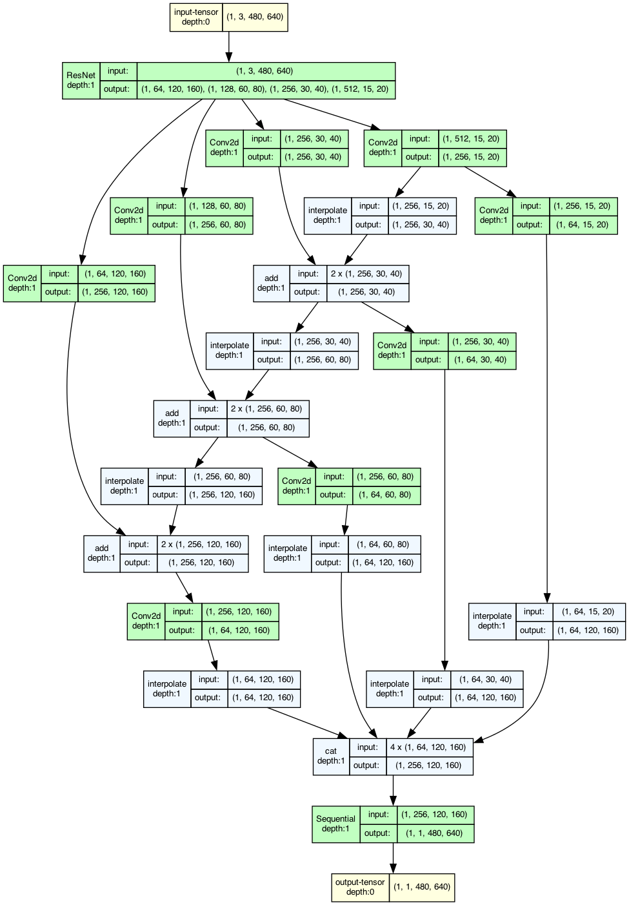
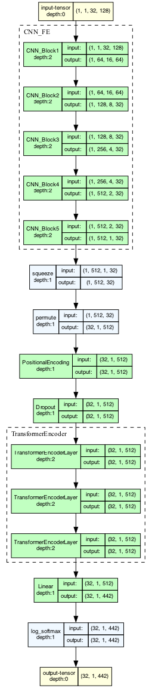

# OCR Model

## Model architecture

The model works in two steps:

1. **Find the text (DBNet):** a network built on ResNet-18 scans the image and draws a box around each word.
2. **Read the text (CNN + Transformer):** each word box is cut out and resized. A CNN turns it into a sequence of features, and a Transformer reads that sequence and predicts the characters.

The words are then put back in reading order: top to bottom, left to right.

### Detection model (DBNet)



### Recognition model (CNN + Transformer)



## Running the model on your machine

> **Note:** Python 3.13+ is required.

### 1. Create and activate a virtual environment

**macOS / Linux**
```bash
python3 -m venv .venv
source .venv/bin/activate
```

**Windows**
```bat
python -m venv .venv
.venv\Scripts\activate.bat
```

### 2. Install the requirements

```bash
pip install -r requirements.txt
```

### 3. Configure `.env`

Make sure the following are set correctly in `.env`:

- the file path to `model.pt`
- the camera index

### 4. Run the model

```bash
python model/cv_inf.py
```

> **Note:** `cv_inf.py` opens a camera window. Direct batch processing of images hasn't been built yet; the inference code is only meant to show the model working.
