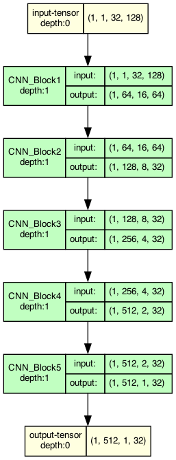
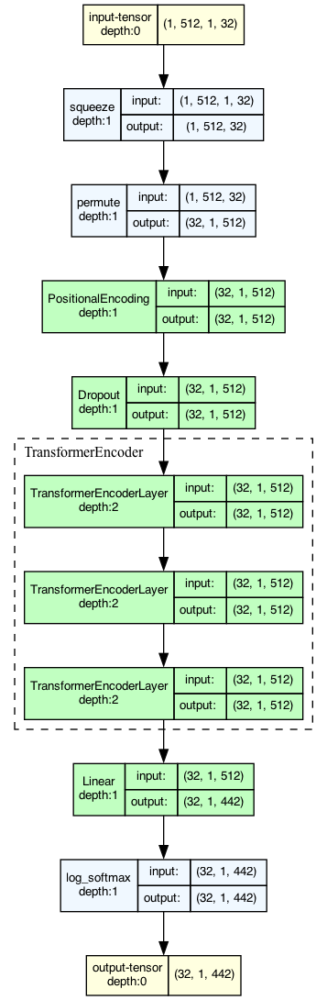
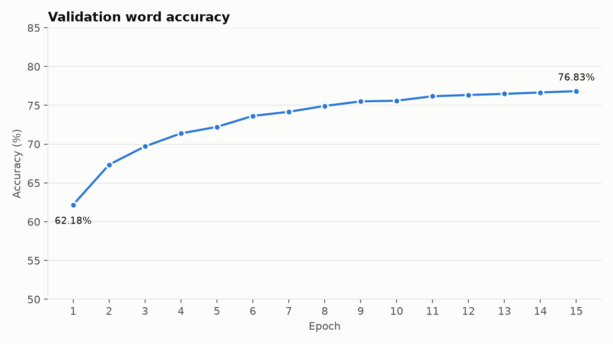
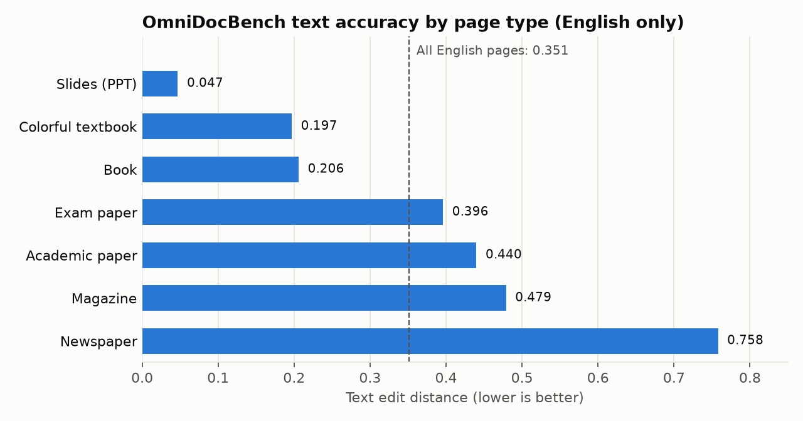

# OCR Model

## Model architecture

The model works in two steps:

1. **Find the text (DBNet):** a network built on ResNet-18 scans the image and draws a box around each word.
2. **Read the text (CNN + Transformer):** each word box is cut out and resized. A CNN turns it into a sequence of features, and a Transformer reads that sequence and predicts the characters.

The words are then put back in reading order: top to bottom, left to right.

### Detection model (DBNet)


### Recognition model (CNN + Transformer)

<table>
  <tr>
    <th>CNN</th>
    <th>Transformer</th>
  </tr>
  <tr>
    <td valign="top"></td>
    <td valign="top"></td>
  </tr>
</table>

## Training results

### Recognition model



After 15 epochs, the recognition model reads 76.8% of validation words exactly right, up from 62.2% after the first epoch.

## Benchmark: OmniDocBench

The model was evaluated on [OmniDocBench](https://github.com/opendatalab/OmniDocBench) (Ouyang et al., CVPR 2025), a document-parsing benchmark from OpenDataLab. See [Acknowledgements](#acknowledgements) for the citation.

> **Note:** the model was tested on the **English pages only** (755 of the 1,651 pages). Its character set has no Chinese characters, so Chinese and mixed-language pages were left out. These scores are not comparable to the full OmniDocBench leaderboard.

Scores are edit distance: 0 is a perfect match and 1 is completely wrong, so lower is better.

| Category | Edit distance |
|---|---|
| Text | **0.351** |
| Reading order | 0.426 |
| Formulas | 0.870 |
| Tables | 1.000 |

The model only reads plain text, so it has no formula or table output, and those two scores are poor by design.



The model reads simple pages well, such as slides (0.047) and single-column pages (0.094). It does worst on multi-column pages such as newspapers (0.758). Words are grouped into lines straight across the page, so text from neighbouring columns gets mixed together.

## Running the model on your machine

> **Note:** Python 3.13+ is required.

### 1. Create and activate a virtual environment

**macOS / Linux**
```bash
python3 -m venv .venv
source .venv/bin/activate
```

**Windows**
```bat
python -m venv .venv
.venv\Scripts\activate.bat
```

### 2. Install the requirements

```bash
pip install -r requirements.txt
```

### 3. Configure `.env`

Make sure the following are set correctly in `.env`:

- the file path to `model.pt`
- the camera index

### 4. Run the model

```bash
python model/proto_inference.py
```

> **Note:** `proto_inference.py` opens a camera window. Direct batch processing of images hasn't been built yet; the inference code is only meant to show the model working.

## Acknowledgements

The benchmark results above use [OmniDocBench](https://github.com/opendatalab/OmniDocBench) by OpenDataLab, released under the Apache-2.0 license.

```bibtex
@misc{ouyang2024omnidocbenchbenchmarkingdiversepdf,
      title={OmniDocBench: Benchmarking Diverse PDF Document Parsing with Comprehensive Annotations},
      author={Linke Ouyang and Yuan Qu and Hongbin Zhou and Jiawei Zhu and Rui Zhang and Qunshu Lin and Bin Wang and Zhiyuan Zhao and Man Jiang and Xiaomeng Zhao and Jin Shi and Fan Wu and Pei Chu and Minghao Liu and Zhenxiang Li and Chao Xu and Bo Zhang and Botian Shi and Zhongying Tu and Conghui He},
      year={2024},
      eprint={2412.07626},
      archivePrefix={arXiv},
      primaryClass={cs.CV},
      url={https://arxiv.org/abs/2412.07626},
}
```
